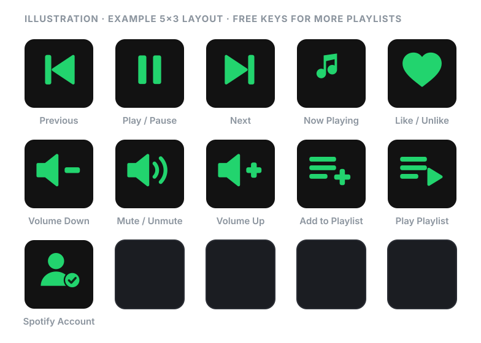
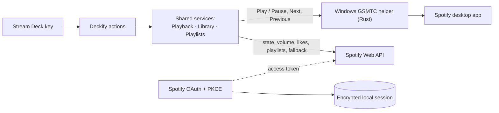

<div align="center">

<h1>
<picture>
  <source media="(prefers-color-scheme: dark)" srcset="assets/brand/deckify-logo-on-dark.svg">
  
</picture>
</h1>

### The Spotify control center your Stream Deck deserves.

Fast local controls. Live Spotify state. Volume, library and playlists — directly from your keys.

**Windows · Stream Deck · Spotify Premium required · Your own Spotify Client ID ([why?](#your-spotify-client-id-explained))**

[](https://github.com/MartinGu04/deckify/actions/workflows/ci.yml)


Unlike plain media keys, Deckify only ever controls Spotify, shows live Spotify state on your keys,<br>and reaches Spotify on your phone or speakers too.

**[Get started](#getting-started)** · [Actions](#actions) · [How it works](#how-it-works) · [Privacy](docs/privacy.md) · [FAQ](#faq)



<sub>Illustration built from Deckify's current key images. Not a photo, and no real track data.</sub>

</div>

## What is Deckify?

Deckify is a Stream Deck plugin for Windows that turns your keys into a Spotify control surface.

- **Live state on the keys:** what's playing, play or pause, the volume, whether a song is liked.
- **Fast control:** commands reach the Spotify app on your PC instantly, and Spotify on your phone or speakers through Spotify Connect.
- **Actions basic media keys can't do:** like songs, add them to a playlist (without duplicates) and start your playlists.

> **Status:** Deckify works today and has been tested on a Stream Deck MK.2. Preparation for a public release is in progress; there is no
> downloadable release yet. See [Getting started](#getting-started).

## Why Deckify

Media keys send play, pause and skip to whichever app Windows thinks is playing, and they show nothing. Deckify is built for Spotify:

- **Instant local controls.** Play / Pause, Next and Previous go straight to the Spotify desktop app through Windows' media controls
  (GSMTC), with no network round trip.
- **Spotify only.** Deckify picks Spotify's media session by app identity. It never pauses YouTube, a browser tab or another player.
- **Works with your other devices.** When the desktop app isn't running, the same keys control the active Spotify Connect device (phone,
  speaker, web player) through the Spotify Web API.
- **Live state.** Now Playing shows the title, artist and progress; Play / Pause shows what a press will do; the volume keys show the
  current volume. One shared, quota-aware poller serves every key.
- **Spotify-native volume and mute.** Deckify sets the volume Spotify itself shows (not the Windows mixer), with a per-key step. Mute
  remembers your volume and Unmute brings it back.
- **Like / Unlike** the current song, with the key showing whether it is in Liked Songs.
- **Add the current song to a playlist,** with duplicate protection: a song already in the playlist is never added twice, even if you
  press twice.
- **Play a playlist** you choose, on the active device.
- **A real playlist picker.** Choose from your playlists in the Stream Deck app, with search and paging. You never type IDs or links.
- **Designed with privacy in mind.** No Client Secret, OAuth with PKCE, a locally encrypted session, and no telemetry.

## Actions

| Action | What the key shows | Path | Settings | Remote Spotify Connect |
| --- | --- | --- | --- | --- |
| **Spotify Account** | Set Up · Connect · Connecting · Connected · Reconnect · Error | Spotify sign-in (OAuth + PKCE) | Guided Spotify setup, Client ID, Connect / Disconnect | — |
| **Previous Track** | Dimmed when unavailable | Local first, Web API fallback | — | ✓ |
| **Play / Pause** | Play or Pause, whichever a press does | Local first, Web API fallback | — | ✓ |
| **Next Track** | Dimmed when unavailable | Local first, Web API fallback | — | ✓ |
| **Now Playing** | Title, artist or show, progress, with Spotify's icon. A press opens the song on Spotify | Web API | — | ✓ |
| **Volume Down** | The current volume | Web API | Volume step (1–50%, default 10%) | ✓ when the device allows it |
| **Volume Up** | The current volume | Web API | Volume step (1–50%, default 10%) | ✓ when the device allows it |
| **Mute / Unmute** | Sound on or muted | Web API | — | ✓ when the device allows it |
| **Like / Unlike** | Whether the current song is in Liked Songs | Web API | — | ✓ |
| **Add to Playlist** | The playlist's name, then **Added** or **Already Added** | Web API | Playlist (your own or collaborative) | ✓ |
| **Play Playlist** | The playlist's name, then **Started** | Web API | Playlist (any in your library) | ✓ |

- **Local first:** a command goes to the Spotify desktop app through Windows' media controls when it is running. Otherwise it goes
  through the Spotify Web API to the active device.
- **When a key can't act,** it says why: **Connect**, **Premium**, **No Device**, **Restricted**, **Limited**, **Unsupported** or **Track
  Only**.

## Requirements

- **Windows 10 or later.** macOS isn't supported.
- **The Stream Deck app 7.1 or later** and an Elgato Stream Deck. Designed for and tested on the 15-key MK.2.
- **Spotify Premium.** Spotify only allows playback control for Premium accounts.
- **A Spotify app with your own Client ID.** It takes a couple of minutes, and Deckify's Spotify Account setup guides you through it.

You do **not** need Node.js, Rust, Git, PowerShell, other developer tools or a Spotify Client Secret to use the packaged plugin.

## Getting started

### 1. Check the requirements

See [Requirements](#requirements). Make sure you're signed in to Spotify with a Premium account.

### 2. Know what the setup will ask

You don't need to prepare anything: Deckify's **Spotify Account** setup walks you through it step by step, with buttons to open the
Spotify Developer Dashboard and copy the values it needs. For reference, it has you:

1. Create an app in the [Spotify Developer Dashboard](https://developer.spotify.com/dashboard) (any name, for example *Deckify*) and
   select **Web API**.
2. Add this **Redirect URI** exactly (`127.0.0.1`, not `localhost`, and no trailing slash):

   ```text
   http://127.0.0.1:43821/callback
   ```

3. Paste the app's **Client ID** into Deckify.

Deckify never asks for the **Client Secret**. Don't copy or enter it anywhere.

### 3. Install Deckify

Deckify doesn't have a public release yet. When it does, installing will take two steps:

1. Download `com.marting.deckify.streamDeckPlugin` from the repository's Releases page.
2. Double-click it. The Stream Deck app installs it, and the **Deckify** category appears in the actions list.

Until then, Deckify can be built from source; see [docs/development.md](docs/development.md).

### 4. Connect Spotify

1. In the Stream Deck app, drag **Deckify → Spotify Account** onto a key and select it. Its settings open Deckify's guided setup.
2. Press **Start setup** and follow the four steps: open the Spotify Dashboard, create the app, add your Client ID, and connect.
3. When you press **Connect Spotify**, your browser opens Spotify's authorization page. Approve it; the page says *Deckify is connected
   to Spotify*, and the key shows **Connected**.
4. Optionally, press **Show me around** for a short tour of what Deckify's keys do.

If something goes wrong (you cancel in the browser, Spotify doesn't answer, or Spotify refuses the account), the setup says what happened
and what to try next. Reopening the settings later shows your connection, not the setup again.

### 5. Add your keys

Drag any Deckify actions onto your keys. For **Add to Playlist** and **Play Playlist**, choose a playlist in the key's settings. Start
playing something in Spotify and press away.

## Your Spotify Client ID, explained

Deckify asks you to create your own Spotify app instead of using a shared Deckify one:

- **No secret to leak.** A Client Secret can't be kept safe inside software you install, so Deckify never uses one. It signs in with
  Spotify's **Authorization Code flow with PKCE**, which is made for installed apps.
- **Your session stays on your PC.** Spotify sends the sign-in result to `127.0.0.1` on your own computer. Deckify stores the session
  encrypted with Windows DPAPI, readable only by your Windows user.
- **You stay in control.** The Spotify app is yours. You can see it in your dashboard, and you can revoke Deckify's access at any time at
  <https://www.spotify.com/account/apps/>.

**Development Mode:**

- New Spotify apps start in Development Mode, which is meant for personal use. These are Spotify's rules, not Deckify's:
  - Spotify currently requires the app's owner to have **Spotify Premium**.
  - Spotify currently allows each new developer **one** Development Mode Client ID.
  - A Development Mode app can authorize up to **five** Spotify accounts: the owner, and accounts the owner adds under **Users
    Management** in the app's settings.
- Deckify doesn't have Spotify's extended (public) API access, so creating your own app is currently the supported way to use it.
- Don't expect to sign in with your account through someone else's app unless they have added you.

## How it works



- **Shared services.** Every key observes the same state: **PlaybackService** (polling, commands, volume, mute), **LibraryService** (Liked
  Songs) and **PlaylistService** (playlist cache, duplicate protection).
- **Instant core controls.** Play / Pause, Next and Previous go first to a tiny bundled Rust helper. It drives Spotify through Windows'
  media controls and never receives Spotify credentials or data.
- **Everything else** goes through the Spotify Web API, signed in with OAuth + PKCE and an encrypted local session.

More in [docs/architecture.md](docs/architecture.md).

## Security and privacy

Deckify was designed to keep your Spotify account safe. It hasn't had a formal security audit, but it limits what it handles:

- **Sign-in:** OAuth 2.0 Authorization Code with PKCE. No Client Secret, ever.
- **Encrypted session:** tokens are encrypted locally (AES-256-GCM), with the key protected by Windows DPAPI (current user).
- **Tokens stay in the plugin.** The Windows helper and the Property Inspector pages never receive them, and they never go into Stream
  Deck settings or browser storage.
- **No shell, fixed commands.** Media commands run without a shell: the helper accepts six fixed commands and only targets Spotify's
  media session.
- **Clean logs.** Production logs leave out tokens and Spotify IDs, URIs and names.
- **Validated links.** Links are checked before opening: only Spotify sign-in, the Spotify Developer Dashboard (a fixed address) and
  `open.spotify.com` playlist, track and episode links.
- **No telemetry.** Deckify talks only to Spotify, with no analytics and no Deckify server.

Details: [docs/privacy.md](docs/privacy.md) · Reporting a vulnerability: [SECURITY.md](SECURITY.md)

## FAQ

<details>
<summary><b>Does Deckify require Spotify Premium?</b></summary>

Yes. Spotify only allows playback control (play, pause, skip, volume, starting playlists) for Premium accounts, and Deckify requires
Premium for all of its controls, including Like and Add to Playlist. With a free account Deckify still connects and Now Playing shows
what's playing, but the other keys show **Premium**.
</details>

<details>
<summary><b>Does it work with Spotify on my phone?</b></summary>

Yes, through Spotify Connect.

- **When it applies:** if the Spotify desktop app isn't running on your PC, Deckify sends commands through the Spotify Web API to the
  active device (phone, speaker, web player).
- **What works:** Now Playing, volume, Like, Add to Playlist and Play Playlist always go through the Web API, so they work whichever
  device is playing.
- **Restricted devices:** if Spotify reports that it doesn't allow remote control of a device, the keys show **Restricted**.
</details>

<details>
<summary><b>Why does the volume key say "Unsupported" for my phone?</b></summary>

Spotify reports, per device, whether its volume can be controlled remotely, and many phones say no. Deckify then shows **Unsupported**
instead of guessing. Use the phone's own volume buttons for that device.
</details>

<details>
<summary><b>Why do I need a Spotify Client ID?</b></summary>

Deckify signs in through a Spotify developer app. Without Spotify's extended access, the supported way is for each user to create their
own app (free, a couple of minutes, and the Spotify Account setup guides you). See
[Your Spotify Client ID, explained](#your-spotify-client-id-explained).
</details>

<details>
<summary><b>Do I need a Client Secret?</b></summary>

No. Deckify uses PKCE, which needs no Client Secret, and it never asks for or stores one. If you have shared your Client Secret
anywhere, rotate it in the Spotify Developer Dashboard.
</details>

<details>
<summary><b>Why does the Spotify Account key say "Reconnect" after an update?</b></summary>

New features sometimes need new Spotify permissions (scopes), and Spotify only grants them when you sign in again. Press **Reconnect
Spotify** once. Your Client ID is kept, and the old session is replaced. Deckify never uses an old session for features it wasn't
authorized for.
</details>

<details>
<summary><b>Does Deckify control YouTube or other browser media?</b></summary>

No.

- **On your PC:** Deckify only controls the Windows media session that belongs to the Spotify app. If Spotify isn't running, it falls
  back to the Spotify Web API; it never sends anything to a browser or another player.
- **Over the Web API:** commands only reach Spotify.
</details>

<details>
<summary><b>Where are my tokens stored?</b></summary>

In `%LOCALAPPDATA%\Deckify\spotify-session.json`, encrypted (AES-256-GCM, with the key protected by Windows DPAPI for your Windows user).
**Disconnect** deletes that file. See [docs/privacy.md](docs/privacy.md).
</details>

<details>
<summary><b>Why does Unmute restore 50% after Stream Deck restarted?</b></summary>

Spotify has no mute: muting means volume 0, and Deckify remembers the previous volume **in memory only**. After Stream Deck restarts,
Deckify doesn't know your earlier volume, so Unmute from 0% restores 50%. Once Deckify has seen a non-zero volume, Unmute restores that.
</details>

<details>
<summary><b>How does Add to Playlist avoid duplicates?</b></summary>

- **The check:** before adding, Deckify reads the playlist's current version and checks whether the song is already in it. It remembers
  the playlist's songs until the playlist changes, so later presses stay fast.
- **Already there:** the key shows **Already Added**, and no second copy is added.
- **Double presses:** a second press while an add is still running is ignored.
</details>

<details>
<summary><b>Does it support macOS?</b></summary>

No. Deckify is Windows-only: its instant local controls use Windows' media controls, and the plugin is published for Windows only.
</details>

<details>
<summary><b>Does it support Stream Deck +, XL, Neo or Mini?</b></summary>

Every Deckify action is a key action, so it can be placed on keys of other Stream Deck models running the Stream Deck app 7.1+ on Windows.

- **Tested:** Deckify is designed and hardware-tested on the 15-key MK.2. Other models are untested.
- **Not supported:** dials and touch strips (Stream Deck +).
</details>

<details>
<summary><b>Is Deckify official Spotify or Elgato software?</b></summary>

No. Deckify is an independent project. It isn't made, endorsed or supported by Spotify or Elgato.
</details>

## Roadmap

**Available now:**

- **Playback:** Spotify Account, Play / Pause, Next and Previous (local first, with Web API fallback), Now Playing.
- **Volume:** Volume Up / Down and Mute / Unmute.
- **Library and playlists:** Like / Unlike, Add to Playlist with duplicate protection, Play Playlist with a real playlist picker.
- **Remote devices:** Spotify Connect control.

**Under consideration** (no dates, no promises):

- choosing the playback device;
- queue controls;
- layouts tuned for Stream Deck +, XL and Neo;
- a ready-made Deckify profile;
- a public release and Elgato Marketplace listing, once the remaining [launch audit](docs/public-launch-audit.md) items are done
  (licence, official Spotify Like icons, release packaging and real product media).

## Documentation

| Document | Contents |
| --- | --- |
| [Architecture](docs/architecture.md) | Services, local and Web API paths, the Windows helper, attribution. |
| [Privacy](docs/privacy.md) | What Deckify stores, sends and logs. |
| [Security policy](SECURITY.md) | Supported versions and how to report vulnerabilities. |
| [Development](docs/development.md) | Building, testing, packaging, CI and logs. |
| [Development history](docs/development-history.md) | Phases 1–8 and the decisions behind them. |
| [Public-launch audit](docs/public-launch-audit.md) | Spotify and Elgato compliance status and launch blockers. |
| [Marketplace readiness](docs/marketplace-readiness.md) | The Elgato Marketplace checklist. |
| [Brand](assets/brand/README.md) · [brand review](docs/brand-review/README.md) | The Deckify brand masters, and how the B1 mark was chosen. |
| [Media](docs/media/README.md) | Capture requirements for screenshots and the hardware demo. |

## Contributing

Building and testing are covered in [docs/development.md](docs/development.md). `npm run check` must pass, and plugin and action UUIDs
must never change.

---

<sub>Deckify is an independent project. Spotify is a trademark of Spotify AB. Elgato and Stream Deck are trademarks of their respective
owners. Deckify is not affiliated with, endorsed by or sponsored by Spotify or Elgato.</sub>
