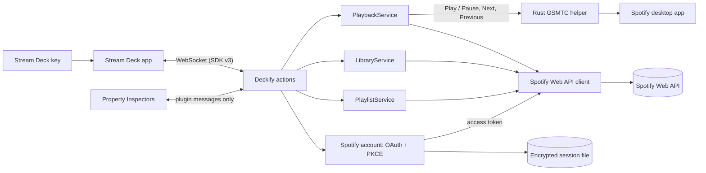

# Deckify architecture

Deckify is a Stream Deck plugin (Elgato SDK v3, TypeScript on Stream Deck's bundled Node.js 24 runtime) with one small native helper for
Windows. This page explains how the parts fit together. For build and test commands see [development.md](development.md); for how the
design got here, see [development-history.md](development-history.md).

## Overview

- **One shared service per concern.** Every key observes the same playback, library and playlist state; keys never call Spotify
  themselves.
- **Local first where it matters.** Play / Pause, Next and Previous go to the local Spotify app through Windows' media controls first, and
  fall back to the Web API.
- **The Web API for everything Spotify-specific:** state, volume, Liked Songs and playlists.
- **Credentials stay in one place.** Only the Spotify account service and the Web API client handle tokens. The native helper, the Property
  Inspectors and the logs never see them.

## Stream Deck layer

| Part | Where | Role |
| --- | --- | --- |
| Entry point | `src/plugin.ts` | Creates the shared services, registers every action, restores the Spotify session on start. |
| Actions | `src/actions/` | One class per action UUID. Each turns shared state into a key image and title and handles presses. |
| Property Inspectors | `com.marting.deckify.sdPlugin/ui/` | Local HTML + JavaScript pages for the Spotify Account (a compact entry point to Deckify Setup), Volume and playlist settings. No remote scripts, no browser storage; they talk only to the plugin. |
| Deckify Setup | `src/setup/`, `ui/setup/` | The guided Spotify setup in the default browser, served by the plugin on `127.0.0.1` while open. See [Deckify Setup](#deckify-setup). |
| Experiences | `src/experiences/`, `ui/setup/experiences.js`, `profiles/` | Two bundled, editable Stream Deck profiles the user picks in Deckify Setup. See [Experiences](#experiences). |
| Manifest | `com.marting.deckify.sdPlugin/manifest.json` | Plugin and action definitions. The plugin and action UUIDs are permanent. |

The legacy **Deckify Status** action (`com.marting.deckify.status`) is still registered so existing keys keep working, but it is hidden from
the actions list (`VisibleInActionsList: false`).

## Shared services

### PlaybackService (`src/playback/`)

- **One poller for all keys.** It runs only while Spotify is connected and a playback key is visible: about every 3 s while playing, 8 s
  while paused and 15 s when nothing is playing. Requests never overlap.
- **After a press,** the state is re-read shortly afterwards.
- **Rate limits:** on HTTP 429 the service waits for `Retry-After` and keeps the last state. When the quota is exhausted, keys show
  **Limited** until the window passes.
- **Command routing for Play / Pause, Next and Previous:**
  1. account checks (connected, Premium);
  2. the local Spotify session through the Windows helper;
  3. the Web API, only if the local path reports *unavailable*.

  An *unknown* local outcome (timeout, crash) is never retried, so one press never skips twice.
- **Volume:** Spotify's own device volume through the Web API, for the desktop app and remote Spotify Connect devices alike. Rapid presses
  are coalesced: each press moves the target immediately, and requests are sent one at a time with the newest target.
- **Mute:** sets volume 0 and remembers the previous volume in memory. Unmute restores it, or 50% when none is known.
- **Play Playlist:** `playContext` starts a playlist on the active device through the Web API.

### LibraryService (`src/library/`)

- Tracks whether the current song is in Liked Songs. It checks once per song while a Like key is visible and never polls.
- Like / Unlike always applies to the song that was playing at the press, even if the next song starts before Spotify answers.
- A second press while one is in flight is ignored.
- Songs only: episodes, ads and local files are never sent.

### PlaylistService (`src/playlists/`)

- **The playlist list:** every page of `/me/playlists`, cached for five minutes and shared by all keys and pickers. Refresh bypasses the
  cache.
- **Writable filter:** Add to Playlist only offers playlists the user owns or collaborates on.
- **No duplicates:** before an add, Deckify reads the playlist's current `snapshot_id`. The item URIs are scanned once per snapshot and
  cached, so a song already in the playlist is never added twice. Adds are serialized per playlist.
- **Identity:** keys store a playlist by ID + URI (never by name).
- Play Playlist goes through the PlaybackService.

### Spotify account (`src/spotify/auth/`, `src/spotify/storage/`, `src/spotify/api/`)

- **Authorization:** Authorization Code flow with **PKCE**, with the user's own Client ID and **no Client Secret**. The redirect URI is
  `http://127.0.0.1:43821/callback`, served by a one-shot listener bound only to `127.0.0.1`.
- **Session storage:** tokens are encrypted in the plugin process with AES-256-GCM. Only the random data key is protected with Windows
  DPAPI (CurrentUser), through Windows PowerShell over stdin. The file is `%LOCALAPPDATA%\Deckify\spotify-session.json`.
- **API client:** on a 401 it refreshes the token once and retries once. Scope changes need an explicit Reconnect; scopes are never added
  through a refresh.
- **Account state for the setup UIs:** the plugin publishes the public account state plus a structured `issue` code
  (`src/spotify/account-issues.ts`, classified by error type, never by message) and, while connecting, whether it is waiting for the
  browser or restoring a session. `src/spotify/account-commands.ts` holds the fixed account commands (save Client ID, connect, retry,
  cancel, disconnect, open the Spotify Developer Dashboard) shared by the Property Inspector and Deckify Setup.

## Deckify Setup

Code: `src/setup/` (server and session) and `com.marting.deckify.sdPlugin/ui/setup/` (the page).

The guided Spotify setup runs in the user's default browser, served by the plugin. The Spotify Account Property Inspector is only a compact
entry point (status, account summary, **Set up Deckify** / **Open Deckify Setup**, Reconnect, Disconnect).

- **Server:** `DeckifySetupServer` starts on demand, bound only to `127.0.0.1` on a port the operating system picks. It never uses port
  43821; if that port is offered, it is released and another is chosen. Spotify's OAuth callback stays on its own one-shot listener at
  `http://127.0.0.1:43821/callback`.
- **Files:** it serves only a fixed list of files (`SETUP_ASSETS`: the page, its script and stylesheet, the shared onboarding model, the
  experience layouts, the favicon and Deckify's action icons). Request paths are never mapped onto the file system.
- **Opening:** the plugin opens `http://127.0.0.1:<port>/setup#launch=<code>` through the same `openUrl` path as other links, after
  checking it against a strict pattern.
- **Session:**
  - The launch code is 256 random bits, kept in memory, valid for two minutes and usable once. It travels in the URL fragment, which
    browsers never send to a server, so it never appears in a request line or a log.
  - The page removes it from the address bar immediately, then exchanges it (`POST /api/session`) for a session token, also 256 random
    bits. The token lives only in the page's memory and is sent in the `X-Deckify-Setup-Session` header; it is never put in a URL, a
    cookie or browser storage.
  - A session ends when the user presses **Done**, when setup is opened again (the old token stops working), after ten idle minutes or
    after two hours. The server then stops. Reloading the page needs a new link from Stream Deck.
- **API:** `GET /api/state?after=<version>` returns the public account state, waiting up to 25 seconds for a change.
  `POST /api/command` runs one of the fixed account commands, `choose-experience` with one of two fixed IDs, or `finish`. Nothing else
  is exposed: no URLs, files, profile names, device IDs, shell or generic plugin commands.
- **Checks on every request:** the `Host` header must be exactly `127.0.0.1:<port>`. API requests must carry the session token; POSTs must
  come from the page's own origin (`Origin`, `Sec-Fetch-Site`) as `application/json`, with bodies of at most 4 KB. There are no CORS
  headers. Every response is `no-store` and carries a strict Content Security Policy (`'self'` only), `nosniff`, `no-referrer` and
  `X-Frame-Options: DENY`.
- **Threat model:**
  - *Other websites in the user's browser* (CSRF, DNS rebinding) can't read or send anything: they can't set the custom header without a
    CORS preflight, which the server refuses, and the Host and Origin checks reject rebinding.
  - *Other machines* can't reach a loopback-only server.
  - *Other local users and processes* would need the 256-bit token, which exists only in the plugin's memory and in the open page. A
    process running as the same Windows user is out of scope: it could already read that user's files and DPAPI-protected data.
  - The page is treated as untrusted presentation. It never receives tokens or the encryption key, so even a fully compromised page can
    only do what the user could do with the setup buttons.
## Experiences

Code: `src/experiences/experiences.ts` (plugin side), `com.marting.deckify.sdPlugin/ui/setup/experiences.js` (layouts and previews),
`com.marting.deckify.sdPlugin/profiles/` (the exports) and `scripts/profiles.mjs` (checks). Details, layouts and how the exports are made:
[profiles.md](profiles.md).

- **What they are:** DECKIFY ⭐ Recommended and SIMPLE, two editable starting layouts for the 15-key Stream Deck / MK.2, bundled as
  real Stream Deck profile exports and registered in the manifest's `Profiles` (`DeviceType 0`, `Readonly`, `AutoInstall` and
  `DontAutoSwitchWhenInstalled` all `false`).
- **Choosing:** after Spotify connects, Deckify Setup offers **Choose my Deckify experience** (the tour stays optional and ends at the
  chooser). The page sends only the experience ID.
- **Switching:** `ExperienceSwitcher` maps the ID to its fixed profile name and calls the SDK's `switchToProfile` for the device whose
  Spotify Account key opened setup. That device comes from the SDK event and stays in the plugin. Other devices get a friendly message
  instead. Concurrent and repeated requests are collapsed.
- **Honesty:** Stream Deck may ask the user to install the profile and doesn't report back, so Deckify says "Finish in Stream Deck" and
  never claims the profile was installed. It stores nothing about the choice.
- **Kept in sync:** the previews, the plugin's mapping, the manifest and the bundled files are compared by tests, `npm run profiles:check`
  and `npm run pack`. The checks also reject personal data and configured playlist keys.

## Windows media bridge (`native/media-bridge/`)

- **What it is:** a small Rust program (`bin/native/deckify-media-bridge.exe`), started once, hidden (no console window), with no shell.
- **Protocol:** one JSON message per line over stdin/stdout. It accepts only `toggle`, `play`, `pause`, `next`, `previous` and `ping`.
- **Spotify only:** it selects the Windows media session (GSMTC) whose app is Spotify (`Spotify.exe` or the Microsoft Store app) and
  never controls a browser or any other media app.
- **No credentials:** it never receives tokens, the Client ID or any Spotify data.
- **Fallback:** if it is missing or keeps failing, Deckify uses the Web API for everything.

## Spotify attribution and links

- **Now Playing:** shows Spotify's official icon next to Spotify metadata. A press opens the current song or episode on
  `open.spotify.com`; the link is built only from a valid item URI.
- **Playlist picker:** shows Spotify's official full logo. The selected playlist and every playlist row have **Open in Spotify**; the
  plugin opens only `https://open.spotify.com/playlist/<same id>` links, and only for the selected playlist or a playlist the picker offers.
- **Playlist keys:** show Deckify's own labels (**Add to Playlist**, **Play Playlist**), never playlist names or other Spotify metadata.
- **Like / Unlike:** the inactive and active key images show Spotify's official + icon and its active state, embedded unmodified; the
  action-list icon is Spotify's + icon SVG. Checking and unavailable use Deckify's own glyphs.
- **Deckify's own artwork:** all other key images and action icons never include Spotify branding.

## Tests

The Vitest suite mocks every Spotify request (fake credentials only). It covers the services against an in-memory Spotify, the actions with
a fake Stream Deck SDK, the Property Inspector protocols, static security guards, the manifest and the documentation. The Rust helper has its
own unit tests. A smoke test runs the built plugin against a simulated Stream Deck connection. CI runs all of it on Ubuntu and Windows; see
[development.md](development.md#continuous-integration).
