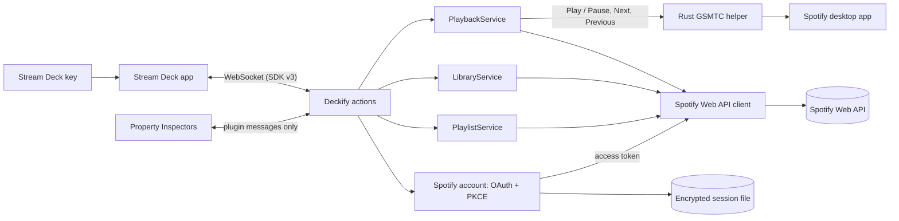

# Deckify architecture

Deckify is a Stream Deck plugin (Elgato SDK v3, TypeScript on Stream Deck's bundled Node.js 24 runtime) with one small native helper for
Windows. This page explains how the parts fit together. For build and test commands see [development.md](development.md); for how the
design got here, see [development-history.md](development-history.md).

## Overview

- **One shared service per concern.** Every key observes the same playback, library and playlist state; keys never call Spotify
  themselves.
- **Local first where it matters.** Play / Pause, Next and Previous go to the local Spotify app through Windows' media controls first, and
  fall back to the Web API.
- **The Web API for everything Spotify-specific:** state, volume, Liked Songs and playlists.
- **Credentials stay in one place.** Only the Spotify account service and the Web API client handle tokens. The native helper, the Property
  Inspectors and the logs never see them.

## Stream Deck layer

| Part | Where | Role |
| --- | --- | --- |
| Entry point | `src/plugin.ts` | Creates the shared services, registers every action, restores the Spotify session on start. |
| Actions | `src/actions/` | One class per action UUID. Each turns shared state into a key image and title and handles presses. |
| Property Inspectors | `com.marting.deckify.sdPlugin/ui/` | Local HTML + JavaScript pages for the Spotify Account (a guided setup), Volume and playlist settings. No remote scripts, no browser storage; they talk only to the plugin. |
| Manifest | `com.marting.deckify.sdPlugin/manifest.json` | Plugin and action definitions. The plugin and action UUIDs are permanent. |

The legacy **Deckify Status** action (`com.marting.deckify.status`) is still registered so existing keys keep working, but it is hidden from
the actions list (`VisibleInActionsList: false`).

## Shared services

### PlaybackService (`src/playback/`)

- **One poller for all keys.** It runs only while Spotify is connected and a playback key is visible: about every 3 s while playing, 8 s
  while paused and 15 s when nothing is playing. Requests never overlap.
- **After a press,** the state is re-read shortly afterwards.
- **Rate limits:** on HTTP 429 the service waits for `Retry-After` and keeps the last state. When the quota is exhausted, keys show
  **Limited** until the window passes.
- **Command routing for Play / Pause, Next and Previous:**
  1. account checks (connected, Premium);
  2. the local Spotify session through the Windows helper;
  3. the Web API, only if the local path reports *unavailable*.

  An *unknown* local outcome (timeout, crash) is never retried, so one press never skips twice.
- **Volume:** Spotify's own device volume through the Web API, for the desktop app and remote Spotify Connect devices alike. Rapid presses
  are coalesced: each press moves the target immediately, and requests are sent one at a time with the newest target.
- **Mute:** sets volume 0 and remembers the previous volume in memory. Unmute restores it, or 50% when none is known.
- **Play Playlist:** `playContext` starts a playlist on the active device through the Web API.

### LibraryService (`src/library/`)

- Tracks whether the current song is in Liked Songs. It checks once per song while a Like key is visible and never polls.
- Like / Unlike always applies to the song that was playing at the press, even if the next song starts before Spotify answers.
- A second press while one is in flight is ignored.
- Songs only: episodes, ads and local files are never sent.

### PlaylistService (`src/playlists/`)

- **The playlist list:** every page of `/me/playlists`, cached for five minutes and shared by all keys and pickers. Refresh bypasses the
  cache.
- **Writable filter:** Add to Playlist only offers playlists the user owns or collaborates on.
- **No duplicates:** before an add, Deckify reads the playlist's current `snapshot_id`. The item URIs are scanned once per snapshot and
  cached, so a song already in the playlist is never added twice. Adds are serialized per playlist.
- **Identity:** keys store a playlist by ID + URI (never by name).
- Play Playlist goes through the PlaybackService.

### Spotify account (`src/spotify/auth/`, `src/spotify/storage/`, `src/spotify/api/`)

- **Authorization:** Authorization Code flow with **PKCE**, with the user's own Client ID and **no Client Secret**. The redirect URI is
  `http://127.0.0.1:43821/callback`, served by a one-shot listener bound only to `127.0.0.1`.
- **Session storage:** tokens are encrypted in the plugin process with AES-256-GCM. Only the random data key is protected with Windows
  DPAPI (CurrentUser), through Windows PowerShell over stdin. The file is `%LOCALAPPDATA%\Deckify\spotify-session.json`.
- **API client:** on a 401 it refreshes the token once and retries once. Scope changes need an explicit Reconnect; scopes are never added
  through a refresh.
- **Guided setup (Property Inspector):** the plugin publishes the public account state plus a structured `issue` code
  (`src/spotify/account-issues.ts`, classified by error type, never by message) and, while connecting, whether it is waiting for the
  browser or restoring a session. `ui/spotify-account/onboarding.js` maps those to screens and guidance; `inspector.js` renders them. The
  page can ask the plugin to connect, retry or cancel a sign-in, disconnect, save the Client ID, or open the Spotify Developer Dashboard
  (a fixed address; the message carries no URL).

## Windows media bridge (`native/media-bridge/`)

- **What it is:** a small Rust program (`bin/native/deckify-media-bridge.exe`), started once, hidden (no console window), with no shell.
- **Protocol:** one JSON message per line over stdin/stdout. It accepts only `toggle`, `play`, `pause`, `next`, `previous` and `ping`.
- **Spotify only:** it selects the Windows media session (GSMTC) whose app is Spotify (`Spotify.exe` or the Microsoft Store app) and
  never controls a browser or any other media app.
- **No credentials:** it never receives tokens, the Client ID or any Spotify data.
- **Fallback:** if it is missing or keeps failing, Deckify uses the Web API for everything.

## Spotify attribution and links

- **Now Playing:** shows Spotify's official icon next to Spotify metadata. A press opens the current song or episode on
  `open.spotify.com`; the link is built only from a valid item URI.
- **Playlist picker:** shows Spotify's official full logo. **Open in Spotify** accepts only `https://open.spotify.com/playlist/<same id>`
  links.
- **Deckify's own artwork:** key images and action icons never include Spotify branding.

## Tests

The Vitest suite mocks every Spotify request (fake credentials only). It covers the services against an in-memory Spotify, the actions with
a fake Stream Deck SDK, the Property Inspector protocols, static security guards, the manifest and the documentation. The Rust helper has its
own unit tests. A smoke test runs the built plugin against a simulated Stream Deck connection. CI runs all of it on Ubuntu and Windows; see
[development.md](development.md#continuous-integration).
