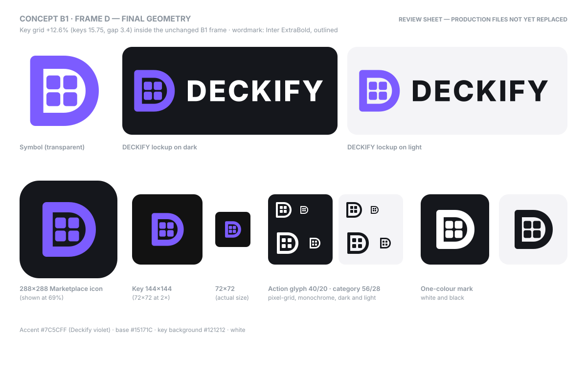
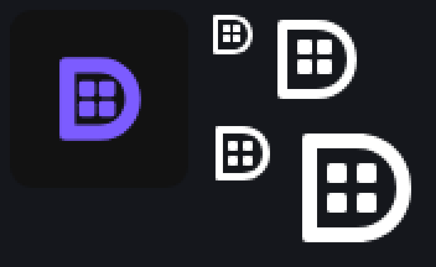

# Deckify brand review

> **Status: B1 · Frame D is the approved Deckify brand and is in production.** B2 and B3 were rejected; Concepts A and C were set aside
> earlier. The production masters live in [`assets/brand/`](../../assets/brand/README.md), generated from `scripts/brand.mjs`. This
> folder keeps the review history.

## Final B1 geometry

### Symbol

Coordinates are in a 100×100 grid, the same as the B1 sheet.

| Part | Geometry | Change from B1 |
| --- | --- | --- |
| Outer D | `M18 10H50C74 10 90 28 90 50C90 72 74 90 50 90H18A6 6 0 0 1 12 84V16A6 6 0 0 1 18 10Z` (78×80, stem corners r 6) | unchanged |
| Counter | `M27 25H50C65 25 75 36 75 50C75 64 65 75 50 75H27Z` (frame 15 at the stem, 15 at top and bottom) | unchanged |
| Keys | four 15.75 × 15.75 squares, corner radius 3.4, gap 3.4, at (30.5, 32.55), (49.65, 32.55), (30.5, 51.7), (49.65, 51.7) | keys 14 → 15.75, gap 3 → 3.4, radius 3 → 3.4 |
| Grid | 34.9 × 34.9, **+12.6%** (was 31 × 31), centred vertically in the counter | |
| Grid clearance | 3.5 to the stem and 3.5 to the bowl (balanced, about one key gap), 7.55 above and below | was 5 / 5.1 / 8 / 11 |
| Colour | `#7C5CFF` Deckify violet, solid | unchanged |

- **Size candidates checked:** +10.6%, +12.6% and +14.2%, each rendered at symbol size and at 42 px (its size on a 72×72 key).
- **Why +12.6%:** at +14.2% the grid gets closer to the bowl than the keys are to each other, and the 72×72 key starts to look crowded.
  At +12.6% the clearance to the frame still matches the gap between keys.

### Small glyphs

The 20×20 and 28×28 glyphs are drawn on their own pixel grids, so every edge lands on a whole pixel. They keep the full 2×2 grid and the
same D proportions.

| Glyph | Geometry (own pixel grid) |
| --- | --- |
| Action icon, 20×20 (40×40 at 2×) | D 16×16, frame 2 px, four 3 px keys with a 1 px gap. Clearance: 2 px to the stem, about 1.5 px to the bowl, 2 px above, 3 px below. The 1 px offset keeps the keys crisp; centring them would land on half pixels and blur them at 20 px. |
| Category icon, 28×28 (56×56 at 2×) | D 22×22, frame 3 px, four 4 px keys with a 2 px gap. Clearance: 2 px to the stem, about 2.2 px to the bowl, 3 px above and below. |

### Wordmark and lockup

- **Wordmark:** "DECKIFY" set in **Inter ExtraBold** (SIL Open Font License, which allows use in logos), letter-spacing 6% of the font
  size. It is converted to outlines, so it doesn't depend on installed fonts.
- **Proportions:** the cap height is half the D's height, the gap after the D is 22 units, and the wordmark is vertically centred on the D.
- **Colour:** white on dark, `#15171C` on light.

## Why a new mark

The development-era Deckify mark (now archived in `assets/brand/archive/development-era/`) is a green "D" with three curved sound lines. That
leans on Spotify's own brand elements: Spotify Green and the three "waves" of the Spotify icon. Spotify's Design & Branding Guidelines don't
allow a third-party app's logo to include or look similar to Spotify brand elements, so that mark can't be Deckify's public identity.

The new identity has to say **Deckify = Stream Deck + control surface**, not "a Spotify clone".

## Shared rules for every concept

- A recognizable **D**, built from Stream Deck ideas: physical keys, key grids, a control surface.
- **No** waves or sound arcs, **no** circular badge, **no** green, **no** Spotify typography, and never combined with Spotify branding.
- Dark charcoal base (`#15171C`), white, and **one Deckify-owned accent** that is clearly not Spotify Green.
- Works on a transparent background, in one colour, and at every size Deckify needs: a 20×20 action-list / category glyph, a 72×72 key,
  the 288×288 Marketplace icon and a large GitHub hero.
- Plain geometry (rectangles, straight lines, one D-shaped curve). Each sheet shows the hero lockup, Marketplace tile, key (2× and actual
  size), the monochrome 40/20 px glyphs on dark and light, and the one-colour mark.

The `DECKIFY` wordmark on the sheets uses a generic geometric sans (Inter / Segoe UI) as a placeholder; the final wordmark should be set in
a licensed typeface and outlined.

## Round 2: refined Concept B variants (B1 selected)

Round 2 kept B's idea, **a D framing a 2×2 Stream Deck-style key grid**, and fixes its main risk: the angled outline could read as a
tag or an arrow.

**Shared choices:**

- **Silhouette:** all three use a real D silhouette: a straight stem with softened corners, and a curved or large-radius bowl.
- **Colour:** Concept A's violet (`#7C5CFF`) as one solid accent. Only B3 adds a single pale tint of the same violet (`#E2DAFF`) for its
  "lit" key.
- **Contrast:** the violet has about 4:1 contrast on both the charcoal base and white.
- **Small glyph:** each variant has its own simplified 20×20 glyph that stays related to the full symbol.

Each sheet shows the standalone symbol, the DECKIFY lockup on dark and light, the 288×288 Marketplace tile, a 72×72 key (at 2× and actual
size), the monochrome 40×40 / 20×20 glyph on dark and light, and the one-colour mark.

### B1 · Frame D

- **What it is:** a classic round-bowl **D** drawn as a frame, with four solid keys inside its counter. One colour.
- **20×20 glyph:** a heavier frame with the grid merged into two stacked keys.
- **Strengths:** the most literal "D containing a deck". The bowl curve makes the D unmistakable. It is calm and typographic.
- **Tradeoffs:**
  - Four keys sit inside a thin frame, so at 72×72 the grid is the smallest of the three.
  - The 20×20 glyph has to drop to two keys, so it relates to the full mark less closely than B2's does.

### B2 · Keycap D

- **What it is:** the **D**'s right side is flat with large rounded corners, like a keycap seen from above, framing a 2×2 grid. One colour.
- **20×20 glyph:** keeps the full 2×2 grid, with bigger keys.
- **Strengths:**
  - The grid has the most room, and it stays a real 2×2 grid at 20×20.
  - It reads most clearly as "control surface", so the full mark and the glyph are nearly the same.
- **Tradeoffs:**
  - The flat right side makes it the closest of the three to a rounded-square app icon. The tight stem corners against the big right
    radii are what keep it a D.
  - At very small sizes it relies on that corner contrast.

### B3 · Solid D

- **What it is:** a solid round-bowl **D** with four rounded keys cut out; one key is "lit" in pale violet.
- **20×20 glyph:** a solid D with two stacked cut-out keys.
- **Strengths:**
  - The boldest and heaviest silhouette: the most visible on a key, in the Marketplace and in the action list.
  - The lit key adds a "status" hint without a second colour family.
- **Tradeoffs:**
  - On light backgrounds the cut-outs show the background, so the lit key and the empty keys look alike (it degrades to four keys).
  - Cut-out squares in a solid shape sit nearer to the familiar "window grid" motif, so the keys are kept rounded.
  - The two stacked holes of the 20×20 glyph can hint at a "B" at a glance.

### Small-size check

- **How it was made:** Chromium rendered each variant at true pixel size; the image is enlarged 5× (nearest neighbour) so the real pixels
  are visible.
- **Layout:**
  - columns: B1, B2, B3;
  - rows: the 20×20 glyph, the 40×40 glyph, and the colour mark at 42 px (its size on a 72×72 key).
- **Result:** all three remain recognizable as a D at 20×20.

## Round 1 (for reference)

Concepts A and C are no longer primary directions. Concept B below is the round-1 version that B1–B3 refine.

## Concept A · Keycap D

- **What it is:** a raised violet keycap with a white **D** pressed into its face. The darker lip under the face makes it read as a
  physical key you press.
- **Why it's Deckify:** "D" plus "Stream Deck key".
- **Why it isn't Spotify:** a rounded square, not a circle; violet (`#7C5CFF`), not green; no lines or waves.
- **How it scales:**
  - The 20 px glyph drops the lip and keeps the D knocked out of a rounded square. It stays crisp because it is just two shapes.
  - On a key, the keycap sits inside the key like a key on a key, which is the most "Stream Deck" of the three.

## Concept B · Key-grid D

- **What it is:** a **D** outline with chamfered (angled) corners instead of a curve, framing a 2×2 grid of keys, with one key "lit".
- **Why it's Deckify:** it reads as a deck of keys inside a D, the clearest "control surface" message.
- **Why it isn't Spotify:** electric blue (`#2F6BFF`); all straight lines and angles, no round shapes at all.
- **How it scales:** the 20 px glyph keeps the outline and merges the grid into one key, because four keys would blur at that size.
- **Risk:** at a glance the angled outline can read as a tag or an arrow; it needs the key grid to read as a D.

## Concept C · Key-column D

- **What it is:** the stem of the **D** is a column of three keys, and the bowl is one solid shape.
- **Why it's Deckify:** a D built out of keys, literally a "deck".
- **Why it isn't Spotify:** signal orange (`#FF6B2C`) is far from Spotify Green, and the keys are rounded squares, not lines or arcs.
- **How it scales:** it is the boldest silhouette at 20 px and on a key.
- **Risk:** the separated stem can read as "ID" or "iD" at small sizes. Slightly wider keys or a smaller gap would help if this direction
  is chosen.

## Comparison

| | A · Keycap D | B · Key-grid D | C · Key-column D |
| --- | --- | --- | --- |
| Accent | Violet `#7C5CFF` | Electric blue `#2F6BFF` | Signal orange `#FF6B2C` |
| Main idea | one physical key | a grid of keys (control surface) | a D built from keys |
| 20 px glyph | very clear | clear (simplified) | very clear |
| Main risk | the most conventional "app icon" | can read as a tag / arrow | can read as "ID" |

The accent colours are suggestions; any concept can take another accent as long as it stays clearly away from Spotify Green.

## Production rollout (done)

1. **Masters:** the vector masters of the symbol, lockups (outlined wordmark) and pixel-grid glyphs are in `assets/brand/`. The
   development-era files are archived in `assets/brand/archive/development-era/`.
2. **Production exports:**
   - plugin icon 256×256 / 512×512 and Marketplace app icon 288×288 (the symbol on the charcoal tile);
   - category icon 28×28 and Deckify Status action icon 20×20 (the pixel-grid glyphs, white on transparent);
   - the Status key images.
3. **Key accent:** the former green `#22D46E` became Deckify violet in the key artwork, Now Playing, the Property Inspectors and the sign-in
   page.
4. **README hero:** uses the light and dark lockups.
5. **Still waiting for real product media:** the Marketplace thumbnail and gallery. Spotify's logo is never part of them.
